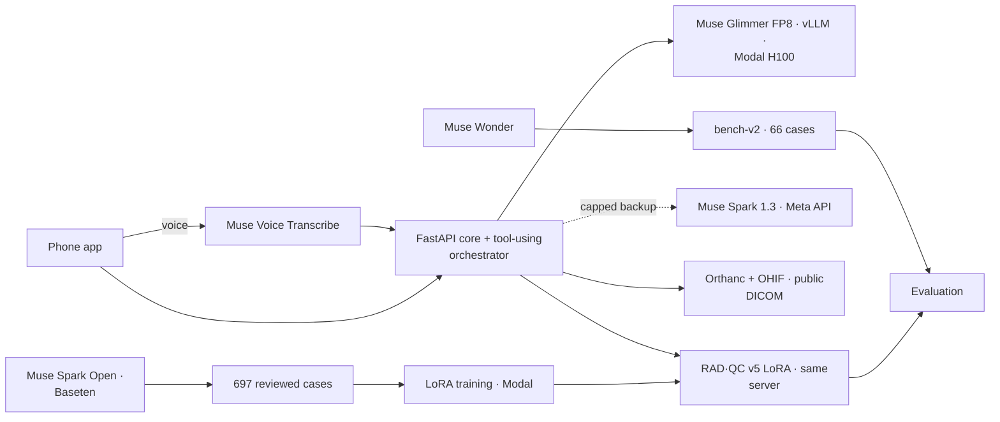

# oncall-resident — for the judges

**Demo video (3 min):** (link) · **Track:** Build for Your World · **Built by:** Miguel Angarita, MD, radiologist and solopreneur (solo entry)

**In one line:** a radiologist-curated checker, fine-tuned on Muse Glimmer, that catches what a radiology report's conclusion leaves out: 62 of 66 on our benchmark vs 53.7 for base Glimmer, about 10× faster (1.35 s vs 14 s median), and zero false alarms on correct reports.

An AI on-call radiology resident in a mobile chat app. It prepares and discusses studies, checks drafts with RAD·QC,
and leaves the decision and the signature to the radiologist.

> **Workflow tool, not a medical device. The radiologist decides and signs.**
> Public DICOM (LIDC-IDRI) and synthetic clinical metadata only. No real patients.

## Why it matters

On a night shift a radiologist reads dozens of studies. Two errors are common and costly: a finding described in the body of the report but missing from the conclusion, which is the part clinicians read; and a clinical question ("rule out pulmonary embolism") that the report never answers. Both can delay treatment, for emergency and outpatient patients alike. RAD·QC checks every draft before signature, in about 1.4 seconds, and quotes the exact sentence it is concerned about. The radiologist stays in charge: the system never diagnoses and never signs.

## What was built during the hackathon (Oct 26 after kickoff – Nov 4)

Every line in this repository: 190 commits (not counting merges) across all branches, each tagged with its Linear issue. The table counts commits per issue on all branches.

| Area | Issue | Commits | Key commits |
|---|---|---|---|
| Repo gate: license, data sources, secret/PHI scanner, FastAPI core, Orthanc DICOMweb adapter | ANG-170 | 49 | `c53602e` (gate), `b9e5802` (core + QIDO adapter) |
| Muse Glimmer served by us on Modal (vLLM, Bearer proxy, scale to zero) and the tool-using orchestrator | ANG-171 | 17 | `3f741b4` → `08d9095` |
| Draft, edit, RAD·QC and two-tap human signature | ANG-172 | 12 | `8641168` → `ec09b6d` |
| Reading-station sync (OHIF viewer follows the phone) | ANG-177 | 8 | `9361a67` → `55e4fe5` |
| Reading order, reading flow, voice, pending items, latency | ANG-173 | 42 | `e2db041` (#7), `7c7096e` (#8 voice), `c025a62` (#9), `60c48a0` (#11 latency) |
| Batch review of the shift | ANG-175 | 8 | `7cd4c8d` → `09126c6` |
| Training data lane: 697 synthetic cases for v5 from Muse Spark Open (generation, review, batches), built with Muse Code | ANG-178 | 35 | `a8a0acf` → `32b891c` (final dataset) |
| RAD·QC v5: taxonomy, data rules, benchmark, LoRA training and serving, Meta backup for QC | ANG-174 | 38 | `810c3ed` (baseline), `701fb8c` (CUDA graphs), `02296c8` (2500 tokens), `c22b1fb` (training manifest), `2594b3a` (LoRA serving fix), `14c865b` (QC backup + "AI review unavailable") |
| Live access for the judges: Glimmer on demand | ANG-176 | 1 | `8670ca8` |

Day-by-day detail, measurements and spend are in [BUILD_LOG.md](BUILD_LOG.md).

## What existed before (not in this repo, no code copied)

| Pre-existing | Used how |
|---|---|
| RadMesh, a private RIS/PACS | Only as a design reference. Here it is an empty adapter stub (`adapters/radmesh`). |
| An earlier Glimmer-on-Modal prototype (Oct 21–26) | Not copied. `serving/` was written from scratch on Oct 27. |
| RAD·QC v3/v4 pilot and RadMesh's v4 training script | v5's training recipe (QLoRA, rank 16) follows the same approach. The code was rewritten here with v5's data rules. |
| AI Mode prototype inside the RIS (Oct 24–25), UI mockup (Oct 26) | Visual concept only |

## Meta models and tools

| Model / tool | Where it runs | What it does |
|---|---|---|
| **Muse Glimmer** (open weights, Apache-2.0), FP8 | Served by us: vLLM on one Modal H100, `serving/glimmer_app.py` | The resident: chat with tools (open case, propose, edit, pending items). It is also the base model for RAD·QC. |
| **RAD·QC v5**, our LoRA adapter on Muse Glimmer (rank 16, trained on Modal) | Served by us on the same vLLM server, model `radqc-v5`, CUDA graphs, text only | Checks every new draft version for omitted findings, an unanswered clinical question and a critical study that needs a second look (`doble_chequeo`). Measurements and laterality are covered by code rules. |
| **Muse Spark Open** (`meta-models/muse-spark-open-1026`) | Baseten (partner inference) | Generated the 697 synthetic training cases for v5. Training data comes only from open-weight models; outputs of the Meta Model API are never used for training. |
| **Muse Wonder** | Meta | Generated bench-v2, the 66-case benchmark. The benchmark is used only for evaluation, never for training. |
| **Muse Code** | Meta (coding agent) | The agent that built the ANG-178 training-data lane: generation, review and the batches of cases. |
| **Muse Spark 1.3** via the Meta Model API | Meta | Backup for the chat and for RAD·QC when Glimmer is down or cold. Synthetic data only, hard spend cap (`META_API_MAX_USD`). |
| **Muse Voice Transcribe 1.0** via the Meta Model API | Meta | Dictation: the phone records WAV, the core transcribes it, and the transcript becomes a chat instruction. Voice never signs. |

## How the training data was curated (radiologist in the loop)

- Muse Spark Open generated 739 accepted cases in 8 batches (873 calls, ~5.7M tokens). A radiologist reviewed a random sample of 10 cases from every batch of ~100 and set the clinical rules below; 697 cases remain after review.
- Omitted finding = a finding with an impact on management that appears in the body and not in the conclusion, regardless of organ or urgency (tumors in outpatients count).
- Minor findings without management impact are not errors (for example, a small knee effusion or a Baker cyst).
- A non-critical question can be answered implicitly in the body ("no consolidation" answers "rule out pneumonia"). Critical questions (pulmonary embolism, aortic dissection, intracranial hemorrhage, pneumothorax, pneumoperitoneum, appendicitis, among others) must be named in the conclusion.
- 3D measurements on X-ray require two orthogonal projections.
- Anti-repetition caps: at most 3 identical 48 mm aortic aneurysms and 6 metaphyseal 30–35 mm lytic lesions; the last batch was prompted for diverse, non-tumor omissions.
- Final composition: omitted finding 164, second look 178, unanswered question 133, controls 222. A sha256 manifest locks the dataset; training refuses mismatched files and any data from the Meta Model API.

## Architecture



## Safety and privacy by design

- Only a human signs (two taps); voice can never sign.
- Public DICOM and synthetic metadata only; a secret/PHI scanner gates every commit.
- The Meta API backup has a hard spend cap and is never used for training data.
- If the AI review cannot run, the app says "AI review unavailable" instead of showing a clean check.

## Results: RAD·QC v5 vs base Glimmer (bench-v2, 66 cases)

Both were measured on the same server: Glimmer FP8 on an H100, vLLM with CUDA graphs, QC `max_tokens` 2500,
temperature 0.6, 3 passes, no Meta backup. Each cell is the mean number of correct cases (range).

| Subtype | n | Base, full system | **v5, full system** | Base, Glimmer only | **v5, Glimmer only** |
|---|---|---|---|---|---|
| omitted finding | 10 | 10.0 | 9.0 | 10.0 | 9.0 |
| unanswered clinical question | 9 | 5.0 | **8.67** | 5.0 | **8.67** |
| second look (`doble_chequeo`) | 8 | 5.33 | 5.33 | 5.33 | 5.33 |
| laterality (rules) | 8 | 8.0 | 8.0 | – | – |
| measurement (rules) | 8 | 8.0 | 8.0 | – | – |
| controls (correct reports) | 23 | 17.33 | **23.0** | 17.33 | **23.0** |
| **Total** | 66 / 50 | 53.67 (53–54) | **62.0 (61–63)** | 37.67 (37–38) | **46.0 (45–47)** |

| | Base | v5 |
|---|---|---|
| Answers cut at 2500 tokens | 3 of 198 | 0 of 198 |
| Time per check, median / max | ~14 s / 33 s | 1.35 s / 2.6 s |

**Limitations**
- **Second look (`doble_chequeo`) stays at 5.33 of 8.** v5 did not improve it over the base model. Three of the eight
  critical studies reported with a normal template still get no "verify" prompt. This is the case the demo must not
  hide: when the checker is silent on a critical study, the radiologist still reads it.
- v5 misses one omitted finding in all 3 passes (B6-0033): a migrated intrauterine device, a clinically
  significant incidental finding, in an otherwise normal abdominal X-ray.
- bench-v2 is a synthetic benchmark of 66 cases. These are not clinical validation numbers.
- Omitted-finding training cases skew toward bone lesions and tumors (110 of 164), and all training data comes from one generator family.

## Live access

The demo is not public. Judges get access on request:

1. Ask us, through the contact on the submission page, with the email you use for Tailscale.
2. We share the demo machine with you through a Tailscale invitation and add your login to the allowlist.
3. Install Tailscale, accept the invitation and open the HTTPS address in the invitation. Nothing else is exposed.

The first request after 25 minutes without use wakes Glimmer, which takes about 2.5 minutes. While it wakes, the chat
and RAD·QC answer through the Meta backup. If Glimmer and the backup both fail, the app says "Revisión IA no
disponible" (AI review unavailable) instead of showing a clean check.

A recorded walkthrough of the same flow is the backup if live access is not possible. Or ask for a live walkthrough over a video call.

## Run it

See `demo/README.md`. The demo is published to a tailnet with `tailscale serve` and asks for a tailnet identity on
the allowlist.

Reproduce the RAD·QC v5 training (2 epochs, rank 16, then the 3-pass measurement on bench-v2). Pass the batches in
alphabetical order: the manifest's sha256 depends on it, and `serving/train_v5.py` refuses files that do not match.

```sh
cd radqc && PYTHONPATH=.:../core python -m radqc.to_chat --out gen/train_chat --inp \
  gen/v5_train_lote_b200.jsonl gen/v5_train_lote_b300.jsonl gen/v5_train_lote_b400.jsonl gen/v5_train_lote_b500.jsonl \
  gen/v5_train_lote_b600.jsonl gen/v5_train_lote_b700.jsonl gen/v5_train_lote_t1.jsonl gen/v5_train_lote_t2.jsonl
cd .. && modal run --detach serving/train_v5.py
```

It takes about 30 minutes and costs ~US$ 1: training US$ 0.82 (25 minutes on an L40S) and the measurement US$ 0.19
(on an H100). Total spend for the hackathon: ~US$ 39.
